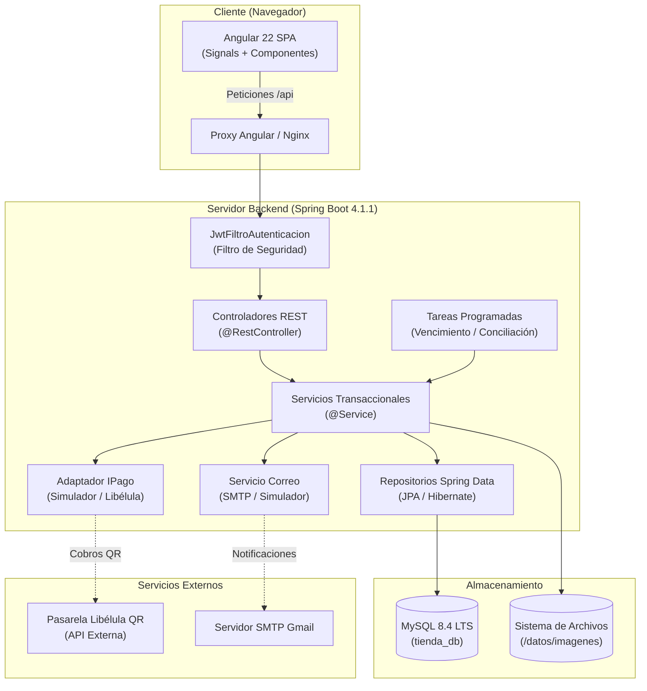
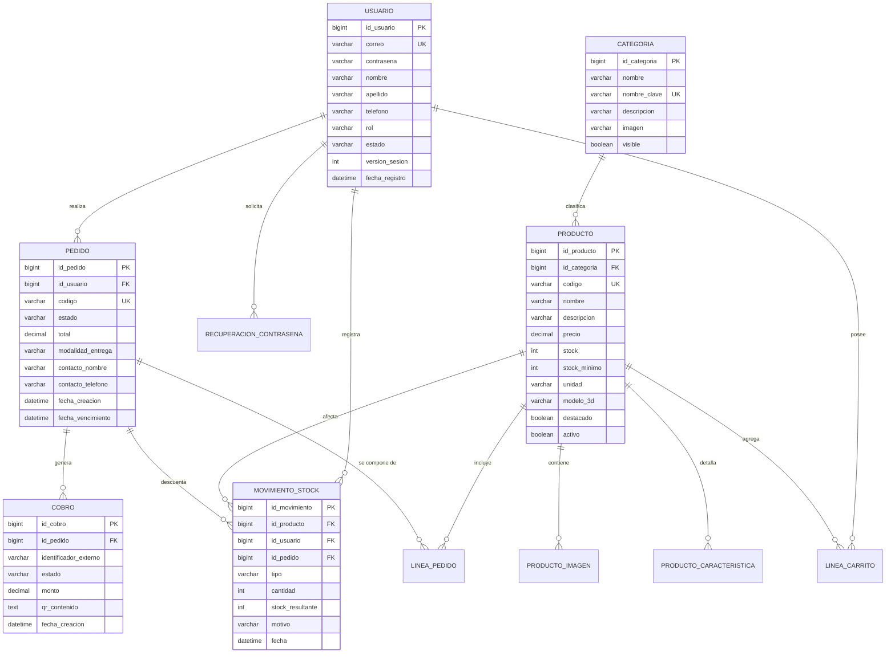

# Arquitectura del Sistema — Tienda Montero

Este documento describe la arquitectura global, patrones de diseño, componentes,
modelo de datos, seguridad y estrategia de despliegue de **Tienda Montero**,
derivado del análisis del código fuente (`backend/`, `frontend/`), configuraciones
y `docs/decisiones.md`.

---

## 1. Visión General y Patrón Arquitectónico

El sistema adopta una arquitectura desacoplada basada en el estilo **Cliente-Servidor
con API RESTful stateless**:

* **Frontend:** Single Page Application (SPA) construida en **Angular 22**,
  responsable de la experiencia de usuario, enrutamiento del lado del cliente,
  manejo de estado reactivo mediante Signals y renderizado visual.
* **Backend:** Servicio web en capas implementado en **Java 21** con **Spring Boot 4.1.1**,
  encargado del procesamiento de lógica de negocio, reglas de dominio, transaccionalidad,
  autenticación/autorización y persistencia de datos.
* **Base de Datos:** Motor relacional **MySQL 8.4 LTS** para almacenamiento persistente
  transaccional, y base de datos **H2 en memoria** para ejecución aislada de pruebas.
* **Comunicación:** Protocolo HTTP/HTTPS con intercambio de datos en formato JSON,
  siguiendo convenciones semánticas REST y códigos de estado estándar.

---

## 2. Arquitectura del Backend (Spring Boot)

El backend se organiza en capas lógicas bien delimitadas dentro del paquete
`bo.edu.uagrm.tienda`:

### 2.1. Capas del Sistema
1. **Controladores (`controller`):**
   * Exponen los endpoints de la API REST (`@RestController`).
   * Validan la estructura de entrada mediante Bean Validation (`@Valid`, `@NotBlank`, etc.).
   * No contienen lógica de negocio; delegan la ejecución a los servicios correspondientes y
     retornan DTOs de respuesta con códigos HTTP semánticos (200, 201, 204).
   * Un manejador centralizado de excepciones (`ManejadorErrores` con `@RestControllerAdvice`)
     intercepta errores de validación, negocio y seguridad, transformándolos en un formato
     unificado `ErrorResponse` (código de error, mensaje y mapa de campos afectados).

2. **Servicios (`service`):**
   * Encapsulan las reglas de negocio y los límites transaccionales (`@Transactional`).
   * Gestionan el ciclo de vida de los pedidos, reservas de stock, cálculo de montos y
     verificación de unicidad.
   * **Módulos desacoplados mediante interfaces:**
     * `IPago` (`service/pago/`): Abstracción del sistema de pagos con dos implementaciones:
       `SimuladorPago` (desarrollo local) y `AdaptadorLibelula` (cobros reales por QR).
     * `ServicioCorreo` (`service/correo/`): Adaptador para envío de correos por SMTP (Gmail)
       o simulación en consola (`simulador`).
   * **Tareas en segundo plano (`@Scheduled`):**
     * `VencimientoPedidos`: Tarea periódica por minuto que cancela pedidos pendientes que
       hayan superado su tiempo límite y libera el stock reservado.
     * `ConciliacionAutomaticaDePagos`: Tarea periódica por minuto que consulta el estado de
       cobros pendientes con el proveedor para asegurar que ningún pago se pierda.

3. **Repositorios (`repository`):**
   * Interfaces que extienden `JpaRepository` de Spring Data JPA.
   * Proporcionan operaciones CRUD y consultas JPQL optimizadas para búsqueda de productos,
     filtrado por categoría y control de stock.

4. **Entidades de Dominio (`entity`):**
   * Modelos persistentes mapeados a tablas de base de datos con JPA/Hibernate.
   * Claves primarias autoincrementales de tipo `Long`.

5. **Seguridad (`security`):**
   * `SecurityConfig`: Define la cadena de filtros de Spring Security, habilitando CORS y
     estableciendo sesiones totalmente stateless (`SessionCreationPolicy.STATELESS`).
   * `JwtFiltroAutenticacion`: Intercepta cada petición HTTP, extrae el token del encabezado
     `Authorization: Bearer <token>`, valida su firma criptográfica y carga la identidad
     del usuario en el `SecurityContext`.

---

## 3. Arquitectura del Frontend (Angular 22)

El cliente web sigue la arquitectura moderna de Angular basada en componentes autónomos
(*Standalone Components*), sistema reactivo de señales (*Signals*) y carga perezosa
(*Lazy Loading*):

### 3.1. Estructura de Módulos y Carpetas
* **`core/`:** Servicios singleton de infraestructura transversal:
  * `auth/`: `AuthService`, gestión del estado de autenticación y almacenamiento del JWT en
    `localStorage`.
  * `guards/`: `authGuard` (protege rutas que requieren inicio de sesión) y `rolGuard`
    (valida pertenencia a roles específicos para acceder al panel administrativo).
  * `interceptors/`: `authInterceptor` (inyecta automáticamente el token Bearer en peticiones
    salientes a `/api`) y manejador global de errores HTTP.
* **`shared/`:** Componentes de interfaz compartidos (botones, diálogos modales, tablas,
  badges de estado), iconos Lucide y utilidades de formato.
* **`features/`:** Módulos funcionales desacoplados cargados bajo demanda por el enrutador:
  * `auth`: Vistas de inicio de sesión, registro y restablecimiento de contraseña.
  * `catalogo`: Portada pública con carrusel de novedades y catálogo filtrable por categoría.
  * `producto`: Ficha técnica de producto, galería de fotos y visor interactivo 3D.
  * `carrito`: Gestión reactiva de ítems y cálculo de subtotales.
  * `checkout`: Confirmación de pedido, dirección de retiro y visualización del código QR de pago.
  * `mis-pedidos`: Consulta histórica y seguimiento de compras para el Cliente.
  * `panel`: Panel de control de uso interno para el personal de la tienda:
    * `/panel/usuarios`: Administración de cuentas y asignación de roles.
    * `/panel/categorias`: Alta, baja y ordenamiento de categorías.
    * `/panel/productos`: Catálogo maestro, subida de fotos e incorporación de modelos `.glb`.
    * `/panel/inventario`: Consulta de existencias y registro de ajustes de stock.
    * `/panel/pedidos`: Despacho y entrega de pedidos para el rol Empleado.
    * `/panel/reportes`: Gráficos y exportación de ventas para el rol Contador.

---

## 4. Modelo de Datos Relacional

El modelo de datos se gestiona automáticamente con Hibernate (`ddl-auto=update`) sobre
MySQL 8.4:

### Tabla de Entidades Principales
* **`usuario`:** Cuentas con roles fijos (`CLIENTE`, `ADMINISTRADOR`, `EMPLEADO`, `CONTADOR`).
  Incorpora `version_sesion` para invalidación inmediata de tokens en caso de cambio de clave.
* **`producto`:** Artículos de ferretería con soporte de `unidad` de venta y enlace a `modelo_3d`.
* **`pedido`:** Cabecera de compra con estados controlados: `PENDIENTE`, `PAGADO`, `ENTREGADO`,
  `CANCELADO`, `VENCIDO`.
* **`cobro`:** Instancia de pago vinculada al pedido y al QR generado por `IPago`.
* **`movimiento_stock`:** Pista de auditoría inmutable de inventario (`INGRESO`, `RESERVA`,
  `LIBERACION`, `VENTA`, `AJUSTE`).

---

## 5. Seguridad y Control de Acceso

1. **Autenticación Stateless por JWT:**
   * Algoritmo: HMAC-SHA256 con clave simétrica de 256 bits (`TIENDA_JWT_SECRETO`).
   * Duración: 8 horas sin refresh token.
   * Contenido del token: `sub` (ID de usuario), `correo`, `rol`, `versionSesion`.
   * **Invalidación reactiva:** Cada petición verifica que la `versionSesion` del token coincida
     con la registrada en la base de datos. Si el usuario cambia de contraseña, es desactivado
     o se le revoca un rol, el token queda inutilizado en su siguiente llamada sin requerir
     servidores de estado como Redis.

2. **Cifrado de Credenciales:**
   * Las contraseñas se encriptan con **BCrypt** (10 rondas de salt).
   * Los tokens de recuperación de contraseña enviados por correo se guardan en la base de datos
     únicamente como hash **SHA-256**, evitando exponer el enlace en caso de fuga de datos.

3. **Protección contra Fuerza Bruta:**
   * Conteo de intentos fallidos por par `(correo, IP)` con ventana deslizante de 15 minutos.
   * Al quinto intento fallido consecutivo, la API responde `HTTP 429 DEMASIADOS_INTENTOS`.

4. **Validación en Backend:**
   * Los guards de Angular sirven exclusivamente para experiencia de usuario y navegación.
   * Toda autorización crítica se comprueba a nivel de controlador y servicio en Spring Security.

---

## 6. Despliegue e Infraestructura

La aplicación está diseñada para operar tanto en entorno local como contenerizada:

### 6.1. Desarrollo Local
* **Backend:** Spring Boot ejecutado directamente mediante `./mvnw.cmd spring-boot:run` (puerto `8080`).
* **Frontend:** Servidor de desarrollo Vite/Angular mediante `npm start` (puerto `4200`).
* **Enlace:** `proxy.conf.json` redirige las peticiones locales `/api` hacia `http://localhost:8080`,
  evitando restricciones de CORS en el navegador.
* **Base de datos:** Instancia local de MySQL 8.4 (en Laragon u homologado).

### 6.2. Contenedorización con Docker Compose (`docker-compose.yml`)
En producción o demostraciones empaquetadas, el sistema levanta tres contenedores en una red
privada aislada:

1. **`base` (MySQL 8.4 LTS):** Almacenamiento persistente en el volumen `datos-mysql`. Sin
   puertos públicos expuestos (solo accesible internamente por el backend).
2. **`backend` (Spring Boot API):** Empaquetado en imagen Docker, perfil `prod`, con volumen
   persistente `imagenes` en `/datos/imagenes`.
3. **`frontend` (Nginx + Angular):** Servidor web Nginx que publica el puerto `80` (o `TIENDA_PUERTO`).
   Sirve los archivos estáticos de la SPA y actúa como proxy inverso reenviando las llamadas `/api/*`
   al contenedor `backend`. De este modo, el frontend y la API comparten el mismo origen,
   eliminando configuraciones de CORS complejas.
