# Casos de uso

Diagrama de casos de uso del sistema, en Mermaid. **Sale de** las historias
de `docs/historias/` y de los issues del repositorio (consultados el
21/10/2026). Los casos con línea punteada corresponden a historias
**planificadas** cuyo PR todavía no está mergeado en `main` (ver
`docs/proyecto/backlog.md`).

```mermaid
flowchart LR
    visitante(("Visitante"))
    cliente(("Cliente"))
    empleado(("Empleado"))
    admin(("Administrador"))
    contador(("Contador"))
    sistema(("Sistema"))

    uc01((Registrarse<br/>HU-01))
    uc02((Iniciar sesión<br/>HU-02))
    uc03((Recuperar contraseña<br/>HU-03))
    uc09((Ver catálogo buscar y filtrar<br/>HU-09))
    uc10((Ver detalle de producto<br/>HU-10))
    uc16((Ver producto en 3D y RA<br/>HU-16))

    uc04((Editar mis datos<br/>HU-04))
    uc11((Gestionar carrito<br/>HU-11))
    uc12((Confirmar pedido<br/>HU-12))
    uc13((Pagar el pedido<br/>HU-13))
    uc14((Ver mis pedidos y su estado<br/>HU-14))
    uc20((Verificar su correo<br/>HU-20))

    uc05((Gestionar usuarios roles y estados<br/>HU-05))
    uc06((Gestionar categorías<br/>HU-06))
    uc07((Gestionar productos<br/>HU-07))
    uc15((Subir el modelo 3D de un producto<br/>HU-15))

    uc08((Registrar entradas y ajustes de stock<br/>HU-08))
    uc17((Ver pedidos pagados y entregarlos<br/>HU-17))

    uc18((Ver reportes de ventas e ingresos<br/>HU-18))
    uc19((Exportar los reportes<br/>HU-19))

    ucDemo((Cargar el catálogo de demostración<br/>issue #25))

    visitante --- uc01
    visitante --- uc02
    visitante --- uc03
    visitante --- uc09
    visitante --- uc10
    visitante --- uc16

    cliente --- uc04
    cliente --- uc11
    cliente --- uc12
    cliente --- uc13
    cliente --- uc14
    cliente --- uc20

    admin --- uc05
    admin --- uc06
    admin --- uc07
    admin --- uc15

    empleado --- uc08
    empleado --- uc17

    contador --- uc18
    contador --- uc19

    sistema --- ucDemo

    classDef planificado stroke-dasharray: 6 4
    class uc14,uc20,uc15,uc16,uc17,uc18,uc19 planificado
```

## Correspondencia caso de uso ↔ historia

| Caso de uso | Historia | Issue | Estado |
|---|---|---|---|
| Registrarse | HU-01 | #3 | Hecha |
| Iniciar sesión | HU-02 | #4 | Hecha |
| Recuperar contraseña | HU-03 | #5 | Hecha |
| Editar mis datos | HU-04 | #6 | Hecha |
| Gestionar usuarios, roles y estados | HU-05 | #7 | Hecha |
| Gestionar categorías | HU-06 | #9 | Hecha |
| Gestionar productos | HU-07 | #10 | Hecha |
| Registrar entradas y ajustes de stock | HU-08 | #11 | Hecha |
| Ver catálogo, buscar y filtrar | HU-09 | #12 | Hecha |
| Ver detalle de producto | HU-10 | #13 | Hecha |
| Gestionar carrito | HU-11 | #15 | Hecha |
| Confirmar pedido | HU-12 | #16 | Hecha |
| Pagar el pedido | HU-13 | #17 | Hecha |
| Cargar el catálogo de demostración | — (chore) | #25 | Código en `main` (PR #44); contenido pendiente |
| Ver mis pedidos y su estado | HU-14 | #18 | Planificada |
| Verificar su correo | HU-20 | #32 | Planificada |
| Subir el modelo 3D de un producto | HU-15 | #19 | Planificada |
| Ver producto en 3D y realidad aumentada | HU-16 | #20 | Planificada |
| Ver pedidos pagados y entregarlos | HU-17 | #21 | Planificada |
| Ver reportes de ventas e ingresos | HU-18 | #22 | Planificada |
| Exportar los reportes | HU-19 | #23 | Planificada |

## Notas

- Los roles son los del enum `Rol`: `CLIENTE`, `ADMINISTRADOR`, `EMPLEADO` y
  `CONTADOR`. El `Visitante` es quien aún no inicia sesión.
- Los roles heredan lo que les corresponde: todo Cliente puede ver el catálogo
  como Visitante, y los permisos de cada rol están en `SecurityConfig`.
- El spike del visor 3D (issue #14) entregó el formato de los modelos; los
  casos HU-15 y HU-16 dependen de ese resultado.
