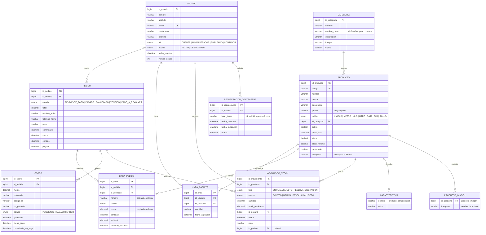

# Diagrama entidad-relación

Modelo de datos de la base de datos. **Sale de** el código de `backend/`
(las entidades de `entity/` en `main`, consultado el 21/10/2026); el esquema
lo genera Hibernate al arrancar, no hay script SQL en el repositorio.

## Notas

- **Tipos:** en la base real, `varchar` respeta los largos de cada columna
  (`correo` 120, `nombre` y `apellido` 80, `codigo` único, etc.) y los
  `decimal` son de tipo `DECIMAL`; el detalle exacto lo fija JPA con las
  anotaciones de cada entidad en `backend/.../entity/`.
- **Enums:** `Rol`, `EstadoCuenta`, `EstadoPedido`, `EstadoCobro`,
  `TipoMovimiento`, `MotivoAjuste` y `UnidadVenta` son enumeraciones de Java
  (`entity/`), guardadas como texto.
- **Stock:** `PRODUCTO.stock` es un contador actual; `MOVIMIENTO_STOCK` es el
  historial de cada cambio (entradas, ajustes, reservas y liberaciones), con
  `stock_resultante` para reconstruir el saldo en cualquier fecha.
- **Pedidos:** `LINEA_PEDIDO` guarda copia de `nombre`, `unidad` y `precio`
  para que el historial no cambie si el producto se modifica después.
- La entidad `VerificacionCorreo` de la HU-20 todavía no está en `main`
  (issue #32, planificada); cuando se mergee hay que agregarla acá.
